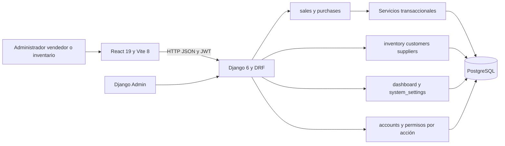
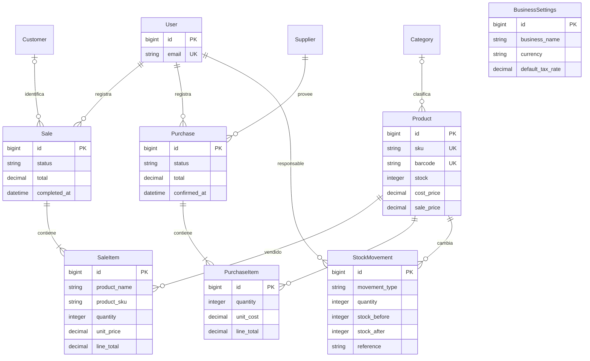
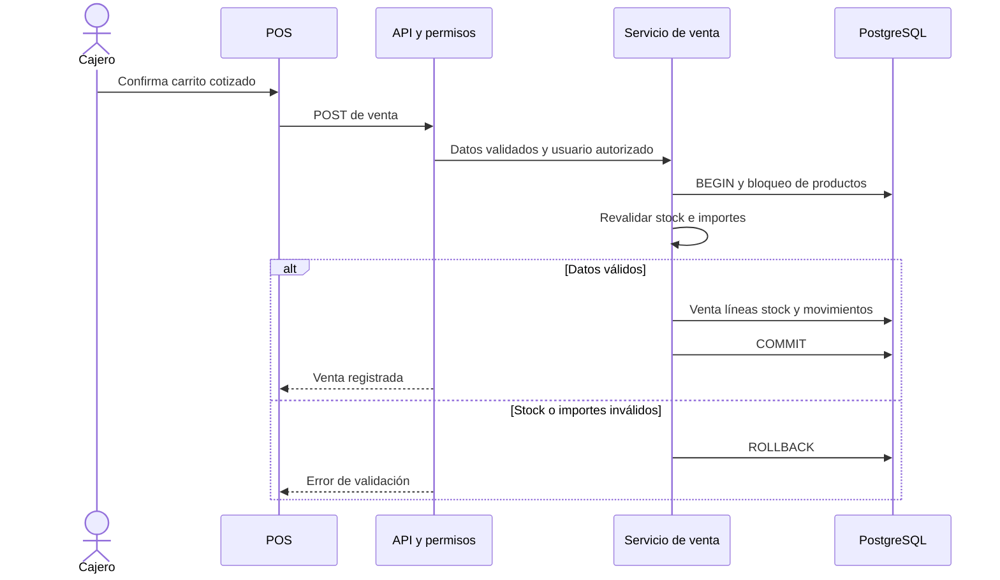

# Arquitectura verificada de BoskePOS

Corte: 16 de septiembre de 2026, revisión local v0.2.1. Estos diagramas describen el código; no representan un despliegue productivo ni un proceso BPMN validado.

## Componentes

BoskePOS es un monolito modular con un cliente React separado. Django concentra autorización, validación y transacciones. PostgreSQL es la base usada en las pruebas completas y de concurrencia; SQLite se usa para la demo aislada y verificaciones complementarias.

`reports` aún no implementa reportería; los indicadores actuales viven en `dashboard`. `system_settings` administra datos del negocio y una proyección de solo lectura para comprobantes. Django Admin permite consultar transacciones; ya no permite mutarlas saltándose los servicios.

## Modelo de datos resumido

Se incluyen campos relevantes, no el esquema completo. El código y las migraciones son la fuente del esquema completo.

Las instantáneas de nombre, SKU y precio conservan el detalle vendido aunque cambie el catálogo. No existe aún costo histórico de salida suficiente para reconstruir márgenes ni snapshot de identidad comercial para reimpresiones. Las cardinalidades de líneas expresan la operación válida de negocio, no una restricción de mínimo de filas impuesta por la base.

## Integridad de una venta

El bloqueo evita que dos cajeros consuman la última unidad en los escenarios probados. No evita repetir una operación válida tras perder su respuesta; se propone idempotencia en v0.3. La cotización no reserva stock. Las ventas pendientes tampoco lo descuentan.

## Despliegue pendiente de validación

La demo usa Vite y `runserver` en localhost; no corresponde a un servidor productivo. Para staging se propone HTTPS en proxy inverso, frontend compilado, proceso Django supervisado, PostgreSQL con respaldos externos, monitoreo del health check y caché compartida según la estrategia de límites. Deben definirse dominio, secretos, imágenes, retención de respaldos y recuperación. Esta propuesta necesita ensayos y costos antes de presentarse como infraestructura implementada.

Referencias: [Django select_for_update](https://docs.djangoproject.com/en/6.0/ref/models/querysets/#select-for-update) y [lista de despliegue Django](https://docs.djangoproject.com/en/6.0/howto/deployment/checklist/).
